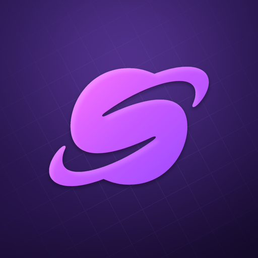

<p align="center"></p>

# StoreRocket for AI assistants

Official plugins that connect AI assistants to [StoreRocket](https://storerocket.io?utm_source=claude&utm_medium=plugin&utm_campaign=agent-plugins), the store locator for your website. Set up your locator, add and update locations, and see what visitors search for, by asking.

| Plugin | What it gives you |
|---|---|
| [`storerocket`](plugins/storerocket) | The StoreRocket connector, plus guided setup and performance reports |

## Install

**Claude:** add **StoreRocket Store Locator** from the plugin directory.

**Claude Code:**

```
/plugin install storerocket --marketplace storerocket/agent-plugins
```

**ChatGPT, Cursor, VS Code and other assistants:** connect the StoreRocket MCP server, `https://storerocket.io/mcp`, as described in the [documentation](https://docs.storerocket.io/api/mcp).

## Help

[Documentation](https://docs.storerocket.io/api/mcp) · [Support](https://storerocket.io/contact) · [Start a free trial](https://storerocket.io/get-started?utm_source=claude&utm_medium=plugin&utm_campaign=agent-plugins)
